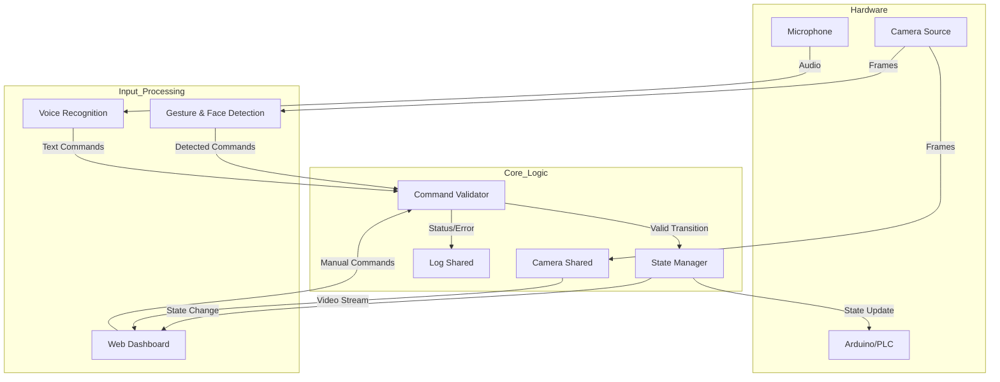

# System Architecture

## Override Overview
The **Safety Monitoring Control System** is a multi-modal interface designed for industrial safety. It integrates Computer Vision (Face/Gesture), Voice Recognition, and Web Technologies into a cohesive control loop.

The system follows a **Producer-Consumer** pattern with a **Centralized State Manager**.

## high-Level Data Flow

## Component Breakdown

### 1. Main Entry Point (`main.py`)
- Initializes global instances.
- Starts background threads for:
  - Dashboard (Flask Server)
  - Voice Control
  - Gesture Control
- Manages the main application lifecycle.

### 2. Core Logic (`core_logic/`)
This module allows different threads to communicate without race conditions.
- **`state_manager.py`**: Singleton that stores the current system mode (`IDLE`, `SCANNING`, `EMERGENCY`, etc.) and Face Detection status.
- **`command_validator.py`**: The "Brain". It receives raw intents (e.g., "STOP") and checks if they are valid given the current state.
- **`camera_shared.py`**: A thread-safe buffer that holds the latest video frame so both the Gesture engine and Web Dashboard can access it.
- **`log_shared.py`**: Centralized logging system that feeds the dashboard UI.

### 3. Gesture & Face Control (`gesture_control/`)
- Uses **MediaPipe** for Hand Tracking and Face Detection.
- **Face logic**: Updates `StateManager` continuously. If no face is visible, access is denied.
- **Gesture logic**: 
  - *Open Hand* → Start
  - *Fist* → Stop
  - *Peace Sign* → Complete
  - *Thumbs Up* → Emergency
- Draws UI overlays (bounding boxes, status text) directly onto the frame before sending it to the dashboard.

### 4. Voice Control (`Voice_control/`)
- Uses **SpeechRecognition** and **PyAudio**.
- Listens continuously in a background thread.
- Fuzzy matches spoken phrases to commands ("Start scan", "Stop", "Emergency").
- Can also answer status queries (e.g., "Why is it stopped?").

### 5. Dashboard (`dashboard/`)
- **Backend (Flask)**:
  - Serves the UI (`index.html`).
  - Streams video via MJPEG (`/video_feed`).
  - API endpoints (`/start`, `/stop`, `/status`) for manual control and real-time updates.
- **Frontend (HTML/CSS/JS)**:
  - Dark/Monochrome "Sci-Fi" aesthetic.
  - Real-time polling for state changes.
  - Command Input box for text-based control.

### 6. Arduino Control (`arduino_control/`)
- Manages Serial communication with the hardware.
- Sends simplified command strings (`START_SCAN`, `RESET`) to the microcontroller.
- Includes a "Dummy Mode" if no device is connected.

## State Machine
The system transitions strictly between these states:

1. **IDLE**: Ready state.
2. **INITIALIZING**: Pre-scan checks.
3. **SCANNING**: Active operation.
4. **STOPPING**: Controlled pause/stop.
5. **STOPPED**: System halted.
6. **COMPLETED**: Task finished.
7. **EMERGENCY**: Immediate halt (Requires manual RESET).

> **Note**: An **EMERGENCY** state locks the system until a `RESET` command is issued.
